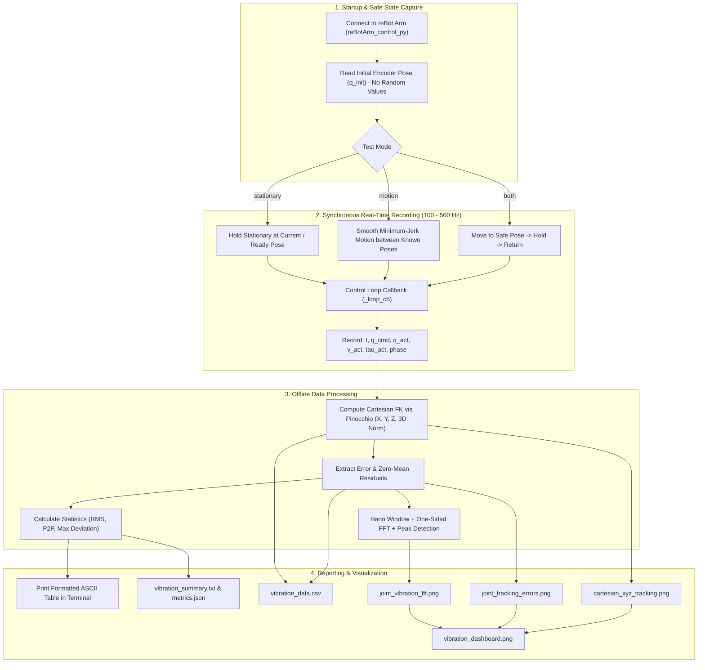

# Implementation Plan: Vibration Analysis Tool for reBot Arm B601

## Goal Description
Build a Python-based vibration and dynamic tracking analysis tool for the reBot Arm B601 robot manipulator. The tool measures, logs, and analyzes physical vibrations, motor jitter, and tracking accuracy using **real encoder feedback** from the robot's Damiao/Robstride joint motors during both stationary holding and smooth trajectory motion.

### Core Objectives
1. **Safety-First Testing (No Random Poses)**: Strictly avoid generating random joint configurations. Use only the robot's current pose or predefined safe poses (e.g. Ready Pose from `config/default.yaml`).
2. **Synchronous Data Logging**: Capture commanded positions, actual encoder positions, velocities, and torques at full control frequency (100–500 Hz) without bus contention.
3. **Cartesian Tool-Tip Tracking**: Compute end-effector $(X, Y, Z)$ position and 3D Euclidean error using Pinocchio forward kinematics.
4. **Spectral Analysis (FFT)**: Identify dominant vibration frequencies (Hz) and mechanical resonance peaks for each joint and Cartesian axis using windowed FFT.
5. **Statistical Metrics**: Quantify vibrations via Root Mean Square (RMS), Peak-to-Peak (P2P), and Maximum Deviation.
6. **Offline Analysis & Reporting**: Save raw data to CSV, export formatted summary reports, and generate publication-quality figures.

---

## User Review Required

> [!IMPORTANT]
> **Strict Policy: No Random Joint Values**:
> Random joint angles will **never** be generated or commanded.
> - **Stationary Test**: The robot holds at its **current actual pose** (read from encoders at startup) or a verified safe pose (such as `ready_pose` in `config/default.yaml`).
> - **Motion Test**: The robot executes a deterministic, smooth minimum-jerk trajectory between two verified safe poses (e.g. Current Pose $\to$ Ready Pose $\to$ Current Pose).
> - **Offline / Math Unit Tests**: Unit tests use deterministic analytical signals ($A_1 \sin(2\pi f_1 t) + A_2 \sin(2\pi f_2 t)$) with known frequencies to mathematically verify the FFT and metric calculations, rather than stochastic/random numbers.

> [!NOTE]
> **Real Motor Feedback Integration**:
> All joint data is sourced from real Damiao/Robstride motor feedback frames received over CAN/serial via `motorbridge`. The recording hook runs inside `RebotArmEndPose`'s periodic control loop callback (`_loop_cb`), ensuring sample time alignment without latency.

---

## What Does This Plan Do & What Is Its Purpose?

### Why Do We Need Vibration Analysis?
1. **PID Gain & Controller Tuning**: High-gain position control (`pos_kp`, `MIT kp/kd`) can cause high-frequency oscillations (motor chatter/buzzing). Low gain causes sluggish tracking or sagging under gravity. Vibration analysis quantifies these oscillations in both amplitude (mrad / mm) and frequency (Hz).
2. **End-Effector Stability for Delicate Tasks**: In tasks like handling liquid tubes (Falcon tubes) or precision grasping, vibrations at the end-effector cause liquid sloshing or grasp failure. Forward kinematics translates joint-level jitter into physical Cartesian tip displacements $(\Delta X, \Delta Y, \Delta Z)$ in millimeters.
3. **Mechanical Resonance Identification**: By analyzing FFT spectra, we can pinpoint specific resonance frequencies (e.g., 8–15 Hz structural resonance vs. 50–100 Hz electrical/control loop chatter), identifying which joint or link is the primary contributor.

### End-to-End Workflow



---

## Proposed Changes

### Core Analysis & Math Engine
#### [NEW] `utils/vibration_utils.py`
A standalone, testable math and plotting module:
- `VibrationSample`: Dataclass containing `t`, `q_cmd`, `q_act`, `v_act`, `tau_act`, `phase`.
- `VibrationDataset`: Container holding recording arrays with metadata (sampling rate, duration, test mode).
- `compute_fk_trajectories(model, q_cmd, q_act)`: Uses `reBotArm_control_py.kinematics.compute_fk` to calculate commanded and actual $(X, Y, Z)$ trajectories and 3D Euclidean errors $\Delta R = \sqrt{\Delta X^2 + \Delta Y^2 + \Delta Z^2}$.
- `calculate_metrics(signal, reference=None)`:
  - $\text{RMS} = \sqrt{\frac{1}{N}\sum (x_i - \bar{x})^2}$ (or tracking error RMS $\sqrt{\frac{1}{N}\sum (x_i - x_{\text{ref}, i})^2}$)
  - $\text{P2P} = \max(x) - \min(x)$
  - $\text{MaxDev} = \max |x_i - x_{\text{ref}, i}|$
- `compute_fft(time_s, signal, top_k=3, min_freq=0.5)`:
  - Zero-mean detrending / residual extraction.
  - Hann windowing `np.hanning(N)` to suppress side-lobe leakage.
  - One-sided FFT `np.fft.rfft` and frequency vector computation.
  - Automatic peak detection for the top 3 dominant vibration frequencies (Hz) and amplitudes.
- `save_csv(dataset, output_path)`: Exports full time-series data (joint angles, Cartesian coordinates, errors).
- `plot_joint_tracking(dataset, save_path)`: 6 subplots showing $q_{\text{cmd}}$, $q_{\text{act}}$, and error $e(t)$ with unit toggle (rad / deg).
- `plot_cartesian_tracking(dataset, save_path)`: Subplots for X, Y, Z (mm) and 3D distance error.
- `plot_fft_spectra(dataset, save_path)`: 6 subplots with frequency spectrum up to Nyquist and labeled peak frequencies.
- `plot_overview_dashboard(dataset, save_path)`: Consolidated summary figure.
- `save_summary_report(dataset, metrics, save_path)`: Human-readable text report and JSON metrics.
- `run_deterministic_math_test()`: Self-test using known analytic multi-tone signals (e.g. 5.0 Hz and 18.0 Hz) to verify FFT and metric algorithms.

---

### Robot Integration & Execution CLI
#### [NEW] `scripts/vibration_analysis.py`
The runnable tool integrating with the robot hardware:
- Loads robot hardware configuration (`rebotarm.yaml` / `rebotarm_dm.yaml`).
- Reads the robot's **current joint pose** upon startup as the reference baseline (guaranteeing safe, collision-free holding).
- Initializes `RebotArm` and `RebotArmEndPose`.
- Hooks synchronously into `_loop_cb` to log data directly at the control rate without thread synchronization jitter or bus contention.
- Implements test routines:
  - **`stationary`**: Arm holds position at current pose or config Ready Pose for `--duration` seconds.
  - **`motion`**: Arm moves smoothly along a minimum-jerk trajectory between current pose and a safe target pose.
  - **`both`**: Arm moves to target $\to$ holds stationary $\to$ returns home.
- Provides `--analyze-only <csv_path>`: Allows re-running analysis and regenerating plots on previously captured CSV files without connecting to the robot.
- Provides `--dry-run`: Runs a simulated deterministic trajectory test without hardware.
- Formats and displays an ASCII summary table directly in the terminal upon test completion.
- Safe lifecycle management: `try ... finally` guarantees `controller.end()` / `rebotarm.disconnect()` on exit or interrupt.

---

## Verification Plan

### Automated Tests (Offline)
1. **Mathematical Verification with Deterministic Signals**:
   - Verify FFT, RMS, P2P, and MaxDev on synthetic multi-tone signals ($f_1 = 5.0\text{ Hz}, f_2 = 18.0\text{ Hz}$):
   ```bash
   python -c "from utils.vibration_utils import run_deterministic_math_test; run_deterministic_math_test()"
   ```
2. **Dry-Run Script Execution**:
   - Verify execution flow, CSV generation, and plot creation:
   ```bash
   python scripts/vibration_analysis.py --dry-run --mode both --duration 3.0 --out-dir /tmp/vib_test
   ```

### Manual Verification on Robot Hardware
1. **Stationary Holding Test (Default & Safest)**:
   - Holds at current pose for 5 seconds:
   ```bash
   python scripts/vibration_analysis.py --mode stationary --duration 5.0
   ```
   - Verify terminal prints the summary table showing joint RMS, P2P, and dominant frequencies.
   - Inspect generated CSV and PNG plots in `data/vibration_analysis/<timestamp>/`.

2. **Motion Trajectory Test**:
   - Smooth movement between safe poses:
   ```bash
   python scripts/vibration_analysis.py --mode motion --duration 3.0
   ```

3. **Offline Re-Analysis**:
   - Run `--analyze-only` on the saved CSV:
   ```bash
   python scripts/vibration_analysis.py --analyze-only data/vibration_analysis/<timestamp>/vibration_data.csv
   ```
